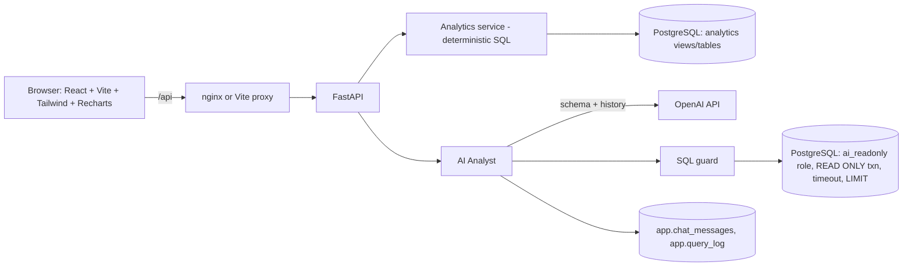
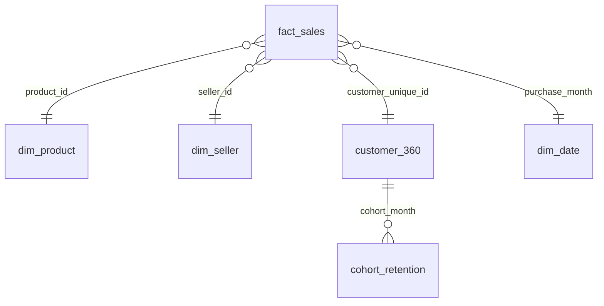

# Architecture



## Chatbot workflow
```mermaid
sequenceDiagram
  participant UI
  participant API
  participant LLM
  participant Guard
  participant DB
  UI->>API: POST /api/chat {message, session_id}
  API->>DB: load last N messages (memory)
  API->>LLM: schema + metric rules + history + question
  LLM-->>API: JSON plan {sql, chart cols, followups} or unsupported
  API->>Guard: validate (SELECT only, allow-list, 1 statement)
  Guard-->>API: ok / reason (1 repair attempt)
  API->>DB: SELECT * FROM (sql) LIMIT n  [read-only role, timeout]
  DB-->>API: rows
  API->>LLM: question + rows -> narrative
  API->>API: chart built from rows; numbers in text checked against rows
  API-->>UI: answer, sql, rows, chart, warnings, follow-ups
```
Without an API key the same pipeline runs with keyword-matched, pre-approved SQL templates ("offline mode").

## ER diagram

(Relationships are logical; FK constraints are not enforced because customer_360 only holds delivered-order customers.)

## Deviations from the brief (deliberate)
- SQLAlchemy **Core + raw SQL** instead of ORM models; SQL files are the single schema source, Alembic runs them.
- No vector DB (not needed). No token streaming. Auth is an optional shared API key (demo only).
- Own tokenizer-based SQL validator instead of a SQL-parser library (see ai-system.md).
